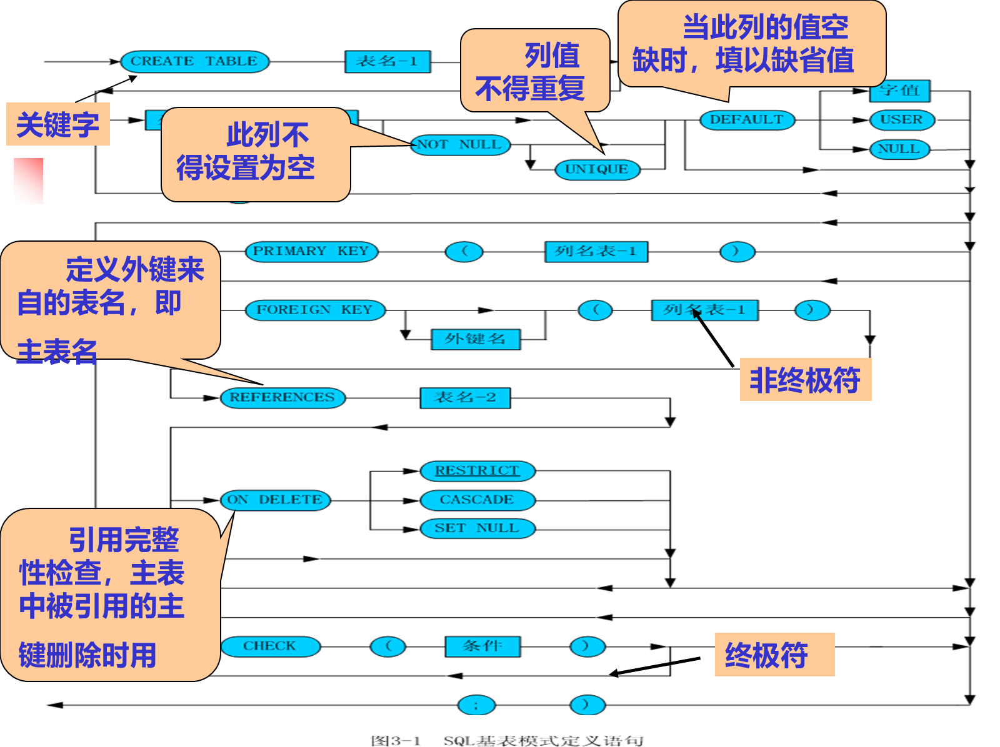
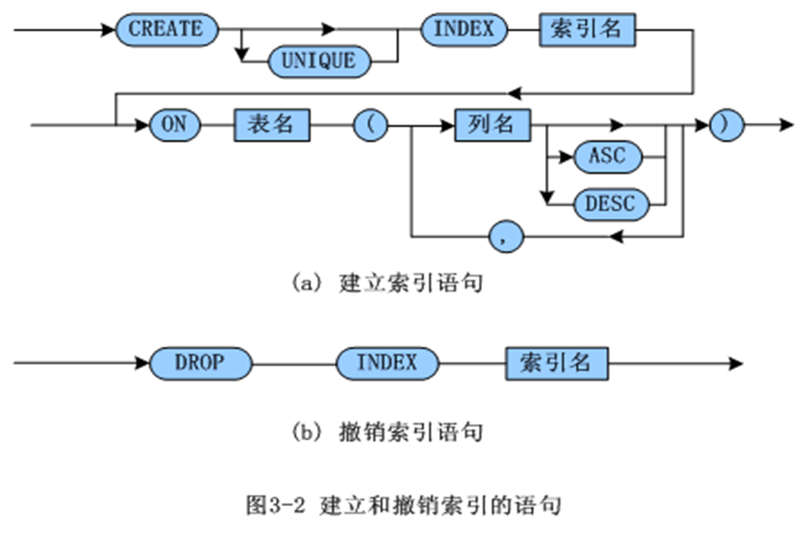
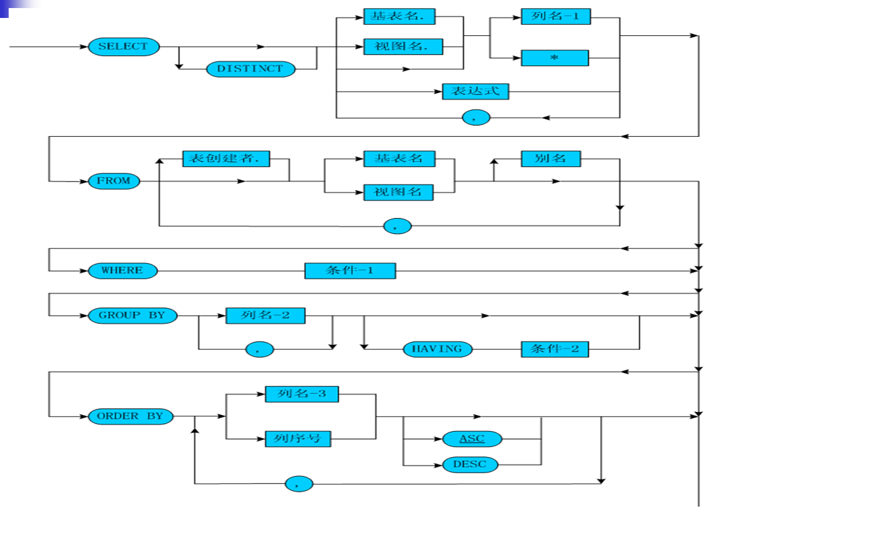
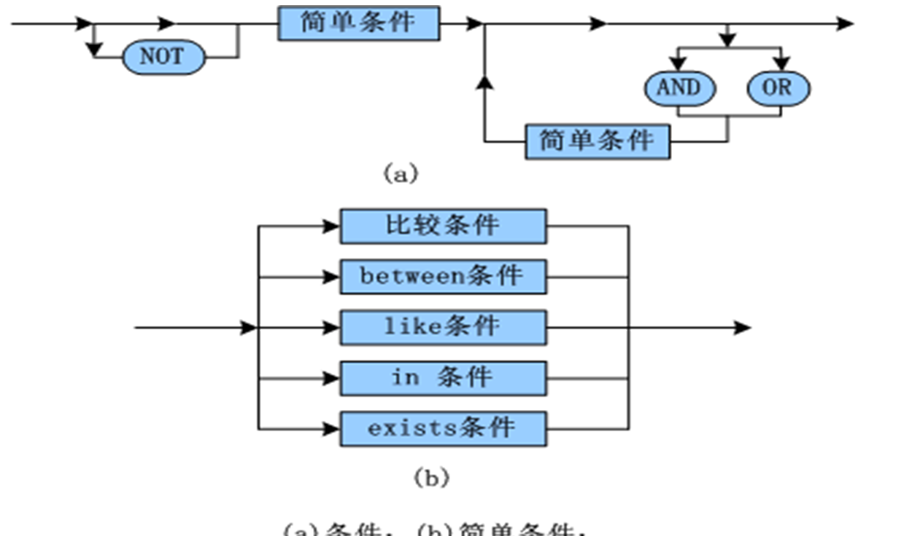
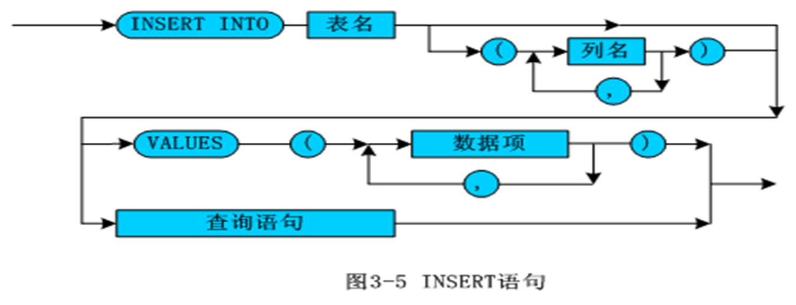
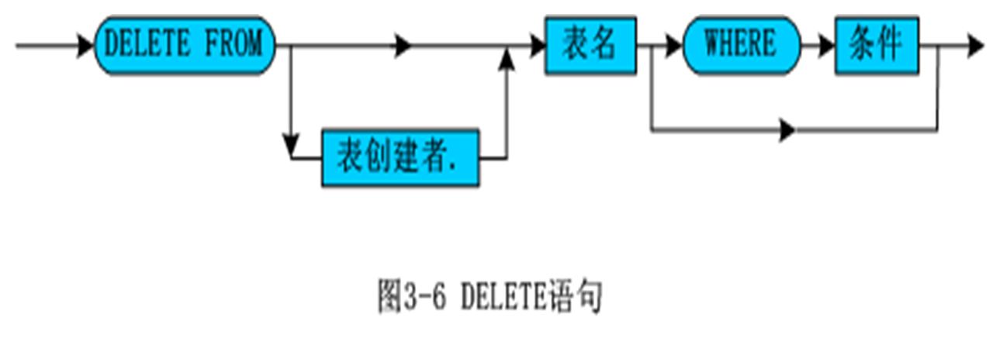
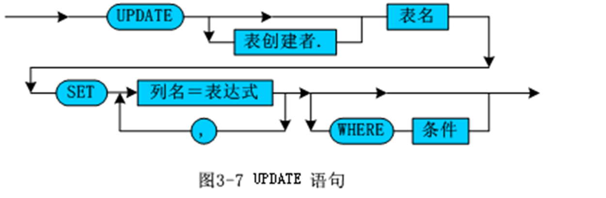
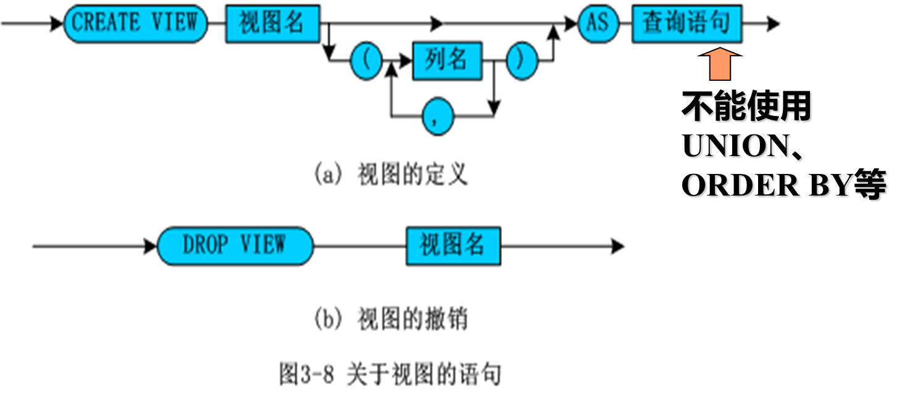
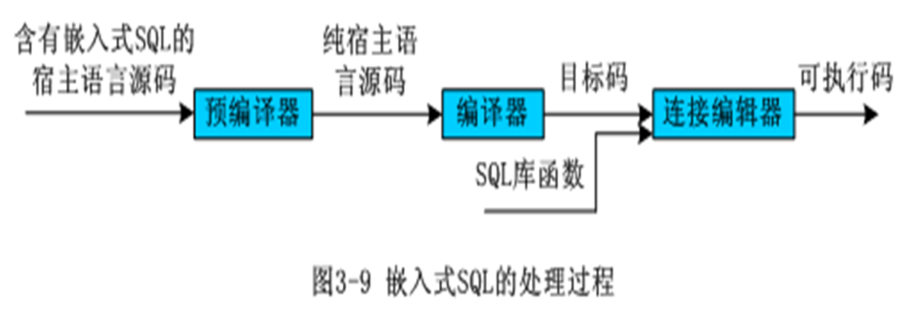

> 源文件：数据库原理(3.SQL).ppt　|　总页数：111　|　页码基准：幻灯片序号
> 笔记语言：中文　|　生成时间：2026-11-16

# 3 数据库语言

本章讲四部分内容：数据库接口（数据库的用户接口是什么、数据库语言与宿主语言的区别）、结构化查询语言 SQL（DDL、QL、DML、DCL）、视图（基表和视图的区别）、嵌入式 SQL（面临的问题和解决方法）。（PPT P1）

## 3.1 数据库的用户接口

DBMS 提供操作命令和数据库语言两种用户接口, 支持用户对数据库进行各类操作，包括数据查询、插入数据 、删除数据、更新数据、定义数据模式、修改数据模式等。（PPT P2）

数据库语言不同于计算完备的程序设计语言，局限于对数据库的操作，称为数据库语言。（PPT P2）

> 这句话把定义放在了后半句：判据是==局限于对数据库的操作==，语法完整、能跑循环和判断的语言不算数据库语言。直接后果是不能独立写应用程序，所以才需要后文的宿主语言。

Procedural language(过程性语言)——基于关系代数发展出来的数据库语言. 用户不仅要告诉系统他需要什么数据，还要告诉系统怎么获取所要的数据。（PPT P3）

Non-procedural/Descriptive language(非过程性/描述性语言)——用户只需要告知他需要什么数据，如何获取这些数据由系统自动实现。（PPT P3）

基于层次数据模型和网状数据模型的数据库系统通常采用过程性数据库语言。关系数据模型抽象层次高，有清晰的数学定义，用户只需要掌握数据的逻辑模式，不需要关心数据的物理存储细节，这些为设计描述性数据库语言提供了较好的基础。（PPT P4）

SQL 是著名的非过程性数据库语言。它将描述操作过程的麻烦由用户转嫁给了系统!（PPT P4）

> 层次、网状模型必须由用户指明存取路径，所以是过程性的；关系模型把存取路径交给优化器，才能只写「要什么」。这条线索解释了 SQL 为什么长成现在这样。

数据库语言不是计算完备的，不能独立用于编写应用程序。目前常见的解决方法是把数据库语言嵌入到某种计算完备的高级程序语言（例如Java等）中，配合完成复杂的数据查询、分析处理工作。这种高级程序语言被称为==数据库语言的宿主语言==。（PPT P5）

关系型数据库语言和宿主语言的区别：

- 关系型数据库语言是以集合论为基础的非过程性语言，主要善于访问数据.
- 宿主语言多数是过程性程序设计语言，主要用于数据处理

> 「善于访问数据」与「主要用于数据处理」是本节的分水岭：一个成批取数，一个逐条加工。两者谁都替代不了谁，只能嵌在一起用。

## 3.2 SQL 的四类功能

根据具体功能，可以把SQL分为四类：（PPT P6）

1. DDL，数据定义语言：定义、撤销、修改数据对象的模式，数据对象包括数据库、表、视图、索引等。
2. Query Language，查询语言
3. MDL, 数据操纵语言. 增加、删除、修改数据.
4. DCL，数据控制语言. 控制数据访问权限。

> 第 3 条课件原文写作「MDL」，是笔误，通用写法为 DML（Data Manipulation Language）。问四类缩写时按 DDL、QL（亦作 DQL）、DML、DCL 作答。

## 3.3 数据定义语言 DDL

### 3.3.1 表的两种存在形式

关系又称为“表”，是关系型数据库系统的基础存储单位，表可以分为两类：（PPT P7）

- 基表——数据显式的存在数据库中.
- 视图——视图是个虚表。仅有逻辑定义，由基表或视图导出，但不作为一个表显式地存储在数据库中。视图可像基表一样，参与各种数据库操作。

（1）普通视图：用户采用Create View命令显式地创建，不再需要时，用户需要用Drop View命令撤销。（PPT P8）

（2）临时视图：对于较复杂的查询，可将查询中相对独立部分作为查询的中间结果，定义为临时视图。临时试图功能上跟普通视图一样，附着与一个查询执行语句中，查询执行完，系统自动撤销临时试图。（PPT P8）

> 原文「附着与」「临时试图」是错字。判据不变：==临时视图的生命周期是一个查询语句==，语句结束即消失，不需 DROP。

**表3.1 通常 SQL 支持的数据类型（PPT P9）**

| 数据类型 | 说明符 | 说明 |
|---|---|---|
| 整数 | INT | 字长32位 |
| 短整数 | SMALLINT | 字长16位 |
| 十进制数 | DEC (m,n) | m为总十进制位数（不包括小数点），n为小数点后的十进制位数 |
| 浮点数 | FLOAT | 一般指双精度浮点数，即字长64位 |
| 定长字符串 | CHAR(n) | 按固定长度n存储字符串。如果实际字符串长小于n，后面填空格符；如果实际字符串长大于n，则报错 |
| 变长字符串 | VARCHAR(n) | 按实际字符串长度存储，但字符串长不得超过n，否则报错 |
| 日期 | DATE | 格式为“yyyymmdd”，yyyy表示年份，范围为0001至9999；mm表示月份，范围为1至12；dd表示日，范围为1至31 |
| 时间 | TIME | 格式为“hhmmss”，hh表示时，范围为0至24；mm表示分，ss表示秒，范围都是0至59 |
| 时标 | TIMESTAMP | 格式为“yyyymmddhhmmssnnnnnn”，nnnnnn表示微秒，范围为0至999999，其它符号的意义同上 |

> CHAR 与 VARCHAR 的差别全在「长度不足时怎么办」：CHAR 补空格、超长报错；VARCHAR 按实际长度存、超长也报错。CHAR 定长带来定长定位的好处，代价是浪费空间。

### 3.3.2 创建基表模式

创建基表模式的完整语法如下图，橙色的注记气泡是对各个可选项的解释：NOT NULL 表示此列不得设置为空，UNIQUE 表示列值不得重复，DEFAULT 表示当此列的值空缺时填以缺省值，CHECK 用于引用完整性检查、在主表被引用的主键删除时使用。（PPT P10）



图3.1 椭圆中是关键字，方框是可替换成分（表名、列名等非终极符），带下划线的方框是终极符；主键、外键、ON DELETE 三个分支各自占据一条回路

**例3-1（PPT P12-P14）** Create three tables STUDENT（学生）， COURSE(课程)，SC（选课）.

```
CREATE  TABLE STUDENT           /*建立学生表*/
(  SNO CHAR(7) NOT NULL,
   SNAME VARCHAR(8) NOT NULL,
   SEX CHAR(2) NOT NULL,
   BDATE DATE NOT NULL,
   HEIGHT DEC(5,2) DEFAULT 000.00，
   PRIMARY KEY (SNO));
```

“;”不是SQL语句的一部分，而是命令结束符。（PPT P12）

```
CREATE TABLE COURSE             /*建立课程表*/
(CNO CHAR(6) NOT NULL,
 LHOUR SMALLINT NOT NULL,
 CREDIT DET(1,0) NOT NULL,
 SEMESTER CHAR(2) NOT NULL,
 PRIMARY KEY (CNO));
```

```
CREATE TABLE SC                 /*建立选课基表*/
(SNO CHAR(7) NOT NULL,
 CNO CHAR(6) NOT NULL,
 GRADE DEC (4,1) DEFAULT NULL，
 PRIMARY KEY (SNO ，CNO)，
 FOREIGN KEY (SNO)  REFERENCES STUDENT  ON DELETE CASCADE，
 FOREIGN KEY (CNO)  REFERENCES COURSE   ON DELETE RESTRICT);
```

FOREIGN KEY (SNO) 一行中，外键来自 STUDENT 表；ON DELETE CASCADE 表示如主表中删除了某一主键，则加此选项的基表中引用此主键的行也随之删除；ON DELETE RESTRICT 表示凡是被基表引用的主键，不得删除。（PPT P14）

> 课件把 CREDIT 的类型写成 `DET(1,0)`，应为 `DEC(1,0)`。SC 的主键是`（SNO，CNO）`这个组合，这是「选课」这类联系表的标准做法：单一属性都不唯一，组合起来才唯一。

“ON DELETE”的三个选项：（PPT P11）

- SET NULL——相应属性设置为NULL.
- RESTRICT—— 凡被基表引用的主键，不得删除
- CASCADE——主表中删除了某记录，则基表中引用该删除记录主键的行也被删除

> 三者对应三种业务语义：删主表时子表跟着删（CASCADE）、子表置空（SET NULL）、干脆不许删（RESTRICT）。默认行为各 DBMS 不同，写语句时最好显式声明。

### 3.3.3 修改基表模式

SQL 提供了7种修改基表模式的命令：（PPT P15-P18）

1. 添加列

```
ALTER TABLE [<Creator of this table>.]<table name表名>
ADD <attribute name 列名><data type类型>；
```

2. 删除基表

```
DROP  TABLE  < table name表名>
```

Note：SQL为什么不提供删除列的命令？（PPT P15）

3. 补充定义主键

```
ALTER TABLE <表名>
ADD PRIMARY KEY （.<列名表>）
```

4. 撤销主键定义

```
ALTER TABLE <表名>
DROP PRIMARY KEY ;
```

思考应用场景！（Why？）（PPT P16）

5. 补充定义外键

```
ALTER TABLE <表名-1>
ADD FOREIGN KEY [<外键名>]（<列名表>）
REFERENCES  <表名-2>
[ON DELETE { RESTRICT | CASCADE |SET NULL}];
```

6. 撤消外键定义

```
ALTER TABLE <表名>
DROP <外键名>;
```

7. 定义和撤消别名

```
CREATE SYNONYM <标识符>
FOR <表的创建者>.{<表名>|<视图名>};
DROP SYNONYM <标识符>;
```

> 课件把「删除列」留成了思考题，答案指向实现代价：删列要重排每一行的定长区、重建所有索引和视图定义，早期系统干脆不提供。补充主键、撤销主键之所以可行，是因为约束是元数据，不动物理结构。

### 3.3.4 索引的建立和撤消



图3.2 (a) 建立索引时 UNIQUE 可选、可对多列建索引且每列可单独指定 ASC 或 DESC；(b) 撤销索引只需索引名

**例（PPT P20）**

```
CREATE  INDEX  H_INDEX ON  STUDENT ( HEIGHT );
```

即：对STUDENT文件建立以HEIGHT为索引值的索引。

```
CREATE  UNIQUE INDEX SC_INDEX
ON SC (SNO DESC, CNO ASC);
```

> 索引建在列上而不是表上，所以撤索引只给索引名、不给表名。UNIQUE 索引同时承担唯一性约束，等于是用索引实现了一个候选键。

## 3.4 查询语言

### 3.4.1 基本查询语句

SELECT 语句的完整语法由五个子句构成，其中 SELECT 与 FROM 必选，其余三个可选。（PPT P21-P22）



图4.1 五个子句自上而下依次是 SELECT、FROM、WHERE、GROUP BY、ORDER BY；SELECT 后可加 DISTINCT，FROM 后可跟多个表并各自取别名，GROUP BY 后可接 HAVING，ORDER BY 后可对每列指定 ASC 或 DESC

- SELECT——指明查询对象. Mandatory.
- FROM——指定查询数据源. Mandatory.
- WHERE ——确定查哪些数据，optional.
- GROUP BY——分组子句, optional.
- ORDER BY——结果排序, optional.

**例3-2（PPT P24-P26）** 查询STUDENT,COURSE，SC三张表的全部内容.

```
SELECT * FROM STUDENT；
SELECT * FROM COURSE;
SELECT * FROM SC
```

**表4.1 STUDENT 表的全部内容（PPT P24）**

| SNO | SNAME | SEX | BDATE | HEIGHT |
|---|---|---|---|---|
| 9309203 | 欧阳美林 | 女 | 1975-6-3 | 1.62 |
| 9208123 | 王义平 | 男 | 1974-8-20 | 1.71 |
| 9104421 | 周远行 | 男 | 1973-7-16 | 1.83 |
| 9309119 | 李维 | 女 | 1976-8-10 | 1.68 |
| 9209120 | 王大力 | 男 | 1973-10-20 | 1.75 |

**表4.2 COURSE 表的全部内容（PPT P25）**

| CNO | LHOUR | CREDIT | SEMESTER |
|---|---|---|---|
| CS-110 | 60 | 3 | 秋 |
| CS-201 | 80 | 4 | 春 |
| CS-221 | 40 | 2 | 秋 |
| EE-122 | 106 | 5 | 秋 |
| EE-201 | 45 | 2 | 春 |

**表4.3 SC 表的全部内容（PPT P26）**

| SNO | CNO | GRADE |
|---|---|---|
| 9309203 | CS-110 | 82.5 |
| 9309203 | CS-201 | 80 |
| 9309203 | EE-201 | 75 |
| 9208123 | EE-122 | 91 |
| 9208123 | EE-201 | 83 |
| 9104421 | EE-201 | 100 |
| 9104421 | CS-110 | 91 |
| 9309119 | CS-110 | 72 |
| 9309119 | CS-201 | 65 |
| 9209120 | CS-221 | 空（NULL） |

> 这三张表的数据贯穿全章所有例题，后面每条语句都能在它们上面验证。注意 SC 最后一行 GRADE 为 NULL——它会被例3-9 的 IS NULL、例3-11 的「成绩不全不统计」反复用到。

**例3-3（PPT P27）** 查询女生身高（单位厘米）

```
SELECT  SNAME, 100*HEIGHT
FROM    STUDENT
WHERE   SEX=’女’；
```

> HEIGHT 存的是米，`100*HEIGHT` 是表达式列，结果列名由系统生成。这类查询说明 SELECT 子句里可以放运算，不必非得是原始列。

### 3.4.2 查询条件较复杂的查询语句

条件的语法分两层：条件由若干简单条件用 NOT、AND、OR 连接而成；简单条件则是比较条件、between 条件、like 条件、in 条件、exists 条件中的任意一种。（PPT P23）



图4.2 (a) 中用 NOT 取反、用 AND 或 OR 把多个简单条件连成复合条件，且可以循环叠加；(b) 列出五种简单条件的形式

**补充（PPT P28-P30）** 查询选修CS-221课程的学生学号和姓名.

==第一种写法，联接查询：==

```
SELECT STUDENT.SNO,SNAME
FROM STUDENT,SC
WHERE STUDENT.SNO=SC.SNO
AND CNO=‘CS-221’
```

用表名前缀限定 SNO 是为了避免两个表都有 SNO 时产生混淆。

==第二种写法，嵌套查询：==

```
SELECT  SNO , SNAME
FROM    STUDENT
WHERE   SNO  IN
        ( SELECT  SNO
          FROM    SC
          WHERE   CNO=‘CS-221’)
```

SELECT 子查询在外层查询执行前完成。即：先在表SC中求出选修课程CS-221的SNO，再在STUDENT表中根据SNO值求出SNAME值。当查询涉及多个关系时，用嵌套查询逐次求解层次分明，具有结构程序设计特点，并且==嵌套查询的执行效率也比联接查询的笛卡儿效率高==。（PPT P29）

==第三种写法，使用存在量词的嵌套查询：==

```
SELECT   SNO , SNAME
FROM     STUDENT
WHERE    EXISTS
         ( SELECT  *
           FROM    SC
           WHERE   SC.SNO=STUDENT.SNO
           AND  CNO=‘CS-221’)
```

EXISTS是存在量词，表示内层查询结果非空。（PPT P30）

> EXISTS 与前一种写法的本质差别是「相关」：内层引用了外层的 STUDENT.SNO，因此内层要按外层每一行反复求值。前一种是先算出集合再判 IN，后一种是逐行试探有无满足者，语义相同、执行路径不同。

**例3-4（PPT P31-P34）** 查询 1976 年出生、且秋季学期有课的学生姓名及其课程号与成绩。

Query condition：born year(1976), semenster(秋季)；Query content：sname，cno，grade

```
SELECT  SNAME, COURSE.CNO, GRADE
FROM  STUDENT, COURSE, SC
WHERE STUDENT.SNO=SC.SNO
AND SC.CNO=COURSE.CNO
AND YEAR(BDATE)=1976
AND SEMESTER＝’秋’；
```

执行时分三步落地：先在 STUDENT 中挑出 1976 年出生的 9309119（李维），再在 COURSE 中挑出秋季开出的 CS-110，最后与 SC 联接取值，结果只有一行——李维、CS-110、72。（PPT P32-P34）

> 三个表必须两两给出等值连接条件，漏掉任何一条都会退化成笛卡儿积。`YEAR(BDATE)=1976` 是函数作用于列，这类写法通常用不上 BDATE 上的索引。

**例3-5（PPT P35）** 查询秋季学期有一门以上课程获90分以上成绩的学生名。

```
SELECT SNAME
FROM  STUDENT
WHERE SNO IN
     （SELECT SNO
       FROM SC
       WHERE GRADE >= 90.0
       AND CNO IN
          （SELECT CNO
            FROM  COURSE
            WHERE SEMESTER=‘秋’)）；
```

集合成员资格比较：（PPT P37）

- （set1）IN（set2）
- （set1）NOT  IN（set2）

Set 1 and set 2 can be a SELECT subquery or a value Collection, but they have the same structure.（集合1与集合2可以是一个SELECT子查询，或是值的集合，但它们的结构相同。）

IN：Every element in set 1 is also in set 2, its logical value is true, otherwise it is false.

NOT IN ：If any element in set 1 is not in set 2, its logical value is true, otherwise it is false.

> 注意 IN 与 NOT IN 的判定口径不对称：IN 要求「每一个」都在 set2 里才算真，NOT IN 只要「有一个」不在 set2 里就算真。NULL 混进集合时两者都会失真，这是 NOT IN 最常见的坑。

**例3-6（PPT P38）** 查询只有一人选修的课程号。

```
SELECT  CNO
FROM  SC SCX
WHERE CNO NOT IN
     (SELECT CNO
      FROM SC
      WHERE SNO <> SCX.SNO);
```

SCX 是别名，用它将外层与内层的同一个表区分开。（PPT P38）

> 这条语句的读法是「不存在别人也选了这门课」。`<>` 把本行自己排除掉，剩下的若为空，说明这门课只有这一个人选。

**例3-7（PPT P40）** 查询选修CS-110课程的学生名。

```
SELECT SNAME
FROM   STUDENT ,SC
WHERE  STUDENT.SNO = SC.SNO
AND  CNO = ‘CS-110’；
```

**例3-8（PPT P41）** 查询学生的平均身高。

> 课件这一页只给出了题干与结果，语句需自行补全：`SELECT AVG(HEIGHT) FROM STUDENT;`。AVG 是聚集函数，作用在整表上时不需要 GROUP BY。

**例3-9（PPT P42）** 查询缺成绩的学生名及课程号。

```
SELECT SNAME, CNO
FROM STUDENT, SC
WHERE STUDENT.SNO=SC.SNO
AND GRADE IS NULL;
```

> 空值判定只能用 `IS NULL`，写成 `GRADE = NULL` 恒为假——这是必考的一处。

**补充（PPT P43）** 查询至少选修课程号为CS-110和CS-201的学生学号。

```
SELECT X.SNO
FROM SC AS X,SC AS Y
WHERE X.SNO=Y.SNO
AND  X.CNO=‘CS-110’
AND  Y.CNO=‘CS-201’；
```

同一个关系SC在一层中出现两次，为了区别，引入别名X，Y，也可看成定义了两个元组变量X，Y。在语句中应用别名加以限定。保留字AS可省。（PPT P43）

> 「至少选修两门」用自连接做交集，是这类题的通用套路：一门课一个元组变量，各自带一个课程号条件，再用等值条件把同一学生绑起来。

### 3.4.3 GROUP BY和 ORDER BY 子句的应用

GROUP BY子句按列值分组。列值相同的分为一组。当其后有多个列名时，则先按第一列名分组，再按第二列名在组中分组，直到GROUP子句指名的列都具有相同值的基本组，HAVING后的条件是选择基本组的条件。（PPT P45）

ORDER BY子句对查询结果按指定列值排序。ASC表示升序，DESC表示降序，缺省时为升序。当有多个列名时，先按第一列名排序，再按第二列名排序，…。（PPT P45）

> 一句话区分：WHERE 筛选的是元组，HAVING 筛选的是组。GROUP BY 之后剩下的每一行是一个基本组，聚集函数就是在这个层次上算的。

**例3-10（PPT P46）** 查询男生与女生的平均成绩。

```
SELECT  SEX，AVG(GRADE)
FROM   Student，SC
WHERE  Student.sno = SC.sno
GROUP BY SEX       /*按SEX分组*/
```

**例3-11（PPT P47）** 试列出计算机系所开课程的最高成绩、最低成绩和平均成绩。如果某门课程的成绩不全（即 GRADE 中有NULL出现），则该课程不予统计，结果按CNO升序排列。

```
SELECT CNO, MAX (GRADE),MIN (GRADE),AVG(GRADE)
FROM   SC
WHERE  CNO Like ‘CS*’      /*选择计算机系所开的课程*/
GROUP BY CNO               /*按CNO 分组*/
HAVING CNO NOT IN (SELECT CNO
                   FROM SC
                   WHERE GRADE IS NULL)  /*删去成绩不全的记录*/
ORDER BY CNO;              /*按CNO升序排序*/
```

注：加了GROUP BY后，SELECT 子句中的各值（表达式）在基本组中应是唯一的！（PPT P48）

> 最后这句注是分组查询的合法性问题：SELECT 里要么出现分组列，要么出现聚集函数，不能出现组内取值不唯一的裸列。另外，聚集函数本身跳过 NULL，所以「成绩不全不统计」得靠 HAVING 显式剔除，不能指望 AVG 自动处理。

思考：where和having子句，都可以描述筛选条件，什么条件适合放在where里，什么样的条件适合放在having里？（PPT P49）

- 保证查询结果正确
- 筛选的粒度、查询效率

> 判据是「能不能在分组前判断」：只涉及单行的条件放 WHERE，先缩小数据量；涉及聚集结果的条件只能放 HAVING。放错位置要么报错，要么白算一遍。

### 3.4.4 包含UNION的查询

SQL还提供了一些集合运算，如UNION（并）、INTERSECTION（交）、MINUS（差）。（PPT P50）

注：参与集合运算的两个关系必须具 有相等的目，且对应的属性域相同。（PPT P50）

**例3-12（PPT P51）** 查询1973年出生的学生和选修电机工程系所开课程（EE标志）的学生的学号。

```
SELECT SNO
FROM STUDENT
WHERE YEAR(BDATE)=1973
UNION
SELECT SNO
FROM SC
WHERE CNO=‘EE*’;
```

注：做UNION运算时，必须消除结果的重复项。（PPT P51）

> 并、交、差都建立在「同目同域」上，这就是关系代数里并相容的要求。UNION 默认去重，代价是一次排序；若明知无重复且想省这一步，可用 UNION ALL。

思考题：查询秋季学期有2门以上课程获90分以上成绩的学生名。（PPT P52）

> 与例3-5「一门以上」只差一个量词，但必须换成 `GROUP BY SNO ... HAVING COUNT(*) >= 2` 才写得出来——IN 子查询表达不了「几门」这种计数条件。答案见 3.9 节的语句2。

## 3.5 SQL数据操纵语言

SQL提供了增、删、改数据库中数据的语句。（PPT P53）

### 3.5.1 INSERT 语句 （增加一个元组）

INSERT 语句用来在一个表中插入一个元组：既可以按位置给出 VALUES 列表，也可以接一个查询语句把结果整批插入。（PPT P53）



图5.1 INSERT INTO 之后可选用括号列出列名（多列以逗号分隔），随后二选一：给 VALUES 加数据项列表，或直接接一条查询语句

**例3-13（PPT P54）** 在STUDENT表中插入一个元组。

```
INSERT  INTO  STUDENT
VALUES ( ‘9309204 ’，‘金月明’，‘女’，1976-03-04,1.60)；
```

注：VALUE后面是要插入的元组值，其次序和域应与STUDENT的模式定义一致。（PPT P54）

**例3-14（PPT P55）** 在SC表中插入一元组，成绩暂缺。

```
INSERT INTO SC(SNO,CNO)
VALUES(‘9309204’，‘CS-221’)；
```

插入的元组为：（‘9309204’，‘CS-221’，NULL）。原表中定义GRADE允许为NULL。（PPT P55）

> 不给列名时 VALUES 必须按建表时的列序写全；给了列名就可以只写一部分，缺的列取 DEFAULT 或 NULL。第二种写法是「成绩暂缺」这类场景的标准做法。

**例3-15（PPT P56）** 生成一个女学生成绩临时表FGRADE，表中包括SNAME，CNO,GRADE三个属性。

首先定义一个临时表FGRADE：

```
CREATE TABLE FGRADE
(SNAME VARCHAR(8) NOT NULL,
 CNO   CHAR(6) NOT NULL,
 GRADE DEC(4,1) DEFAULT NULL);
```

其次插入有关的数据：

```
INSERT INTO FGRADE
SELECT SNAME, CNO, GRADE
FROM  STUDENT,SC
WHERE STUDENT.SNO=SC.SNO
```

> INSERT 接 SELECT 时没有 VALUES 关键字，列数按位置对应。这里漏写了「只取女生」的条件，按题意应补 `AND SEX='女'`。

### 3.5.2 DELETE 语句



图5.2 DELETE FROM 之后是表名（可带表创建者前缀），WHERE 与条件整体可选

注：如果没有WHERE子句，则删除指定表中的所有元组，使该表为一空表。（删除整个表要用 DROP TABLE语句）（PPT P58）

**例3-16（PPT P59）** 从SC表中删除GRADE为NULL的元组。

```
DELETE  FROM  SC
WHERE   GRADE  IS  NULL ;
```

> DELETE 删的是元组，表还在；DROP TABLE 连表定义一起撤销。两者不可混用，答题时写错一个词就是零分。

### 3.5.3 UPDATE（更新）语句



图5.3 UPDATE 之后是表名，SET 后可并列多个「列名=表达式」，WHERE 与条件整体可选

**例3-17（PPT P61）** 将CS-110课程改成春季开出。

```
UPDATE COURSE
SET    SEMESTER=‘春’
WHERE  CNO=‘CS-110’；
```

**例3-18（PPT P62）** 将STUDENT表中的HEIGHT的单位改为厘米。

```
UPDATE STUDENT
SET HEIGHT=100*HEIGHT;
```

> 没有 WHERE 就作用于全部元组，例3-18 正是靠这一点批量换算。等号右侧可以引用该列的旧值，这是更新语句里唯一的「自引用」写法。

## 3.6 SQL中的视图

### 3.6.1 普通视图

视图：是由其它视图或基表导出的虚表。它不是一个存在数据库中的表，而是在数据目录中保留其逻辑定义。当视图参与数据库操作时，可通过修改查询条件，把对视图的查询转换为对基表的查询。（PPT P63）

视图的定义，通常是用户经常要用到的一些数据，或者用户经常要查询的内容。（PPT P64）

视图的内容是静态的，还是动态的？注意：视图对应的内容总是实时、最新的内容，并不是视图定义时对应内容。这是由于基表随着更新操作其内容在不断变化，所以视图对应的内容也在不断变化。（PPT P64）

> 这解答了「视图是不是把查询结果存下来了」：只存定义，不存数据，所以==视图是动态的==。代价是每次访问都要重算，收益是不会出现视图与基表不一致。

视图不再需要时，可以从系统中撤消。（PPT P65）



图6.1 (a) CREATE VIEW 后跟视图名，可选用括号列出列名，AS 之后接查询语句，该查询中不能使用 UNION、ORDER BY 等；(b) DROP VIEW 只需视图名

**例3-19（PPT P67）** 试定义视图ENROL-SPRING,作为学生春季选课一览表，其中含有SNO,SNAME,CNO,CREIT等属性。

```
CREATE VIEW ENROL-SPRING
AS
SELECT SNO,SNAME,CNO,CREDIT
FROM STUDENT,COURSE,SC
WHERE STUDENT.SNO=SC.SNO
AND COURSE.CNO=SC.CNO
AND SEMESTER=‘春’；
```

**例3-20（PPT P68）** 试定义一视图GRADE-AVG，表示学生的平均成绩，其中包括SNAME和AVG GRADE（平均成绩）两个属性。

```
CREATE VIEW GRADE-AVG(SNAME,AVGGRADE)
AS
SELECT SNAME,AVG(GRADE)
FROM STUDENT, SC
WHERE STUDENT.SNO=SC.SNO
GROUP BY SNAME;
```

可见，视图实际上是一个SELECT语句。（PPT P68）

撤消上述两个视图:

```
DROP VIEW ENROL-SPRING;
DROP VIEW GRADE-AVG;
```

注：视图的查询可像基表一样参与数据库操作，但视图的更新则最终落实到有关基表的更新。通常情况下，由连接定义的视图是不可更新的。但如果连接定义的视图所涉及到的几个基表的主键都在视图中时，还是可以更新的（见例3-19）。（PPT P70）

> 例3-19 之所以可更新，是因为 STUDENT.SNO、COURSE.CNO、SC 的主键都出现在视图里，每一行能唯一回溯到基表的一行。例3-20 用了聚集函数，一行对应多行，就回溯不了。

此外，视图更新还会存在一些语义上的问题。例如：由基表COURSE定义一个春季所开课程的视图SPRING如下：（PPT P71）

```
CREATE VIEW SPRING
AS
SELECT CNO,LHOUR,CREDIT
FROM  COURSE
WHERE SEMESTER=‘春’；
```

该视图的元组虽与基表COURSE的元组存在一一对应关系，但若在视图中删除一个元组，如：（PPT P72）

```
DELETE FROM SPRING WHERE CNO=‘CS-20’；
```

这里存在一个语义问题：是CS-20课程从春季开出改为秋季开出？还是CS-20课程要撤消？若为前者，应修改基表的SEMESTER列，而不是删除‘CNO=CS-20’的元组；若为后者，才必须删除‘CNO=CS-20’的元组。（PPT P73）

> 这就是视图更新的根本困难：视图只暴露了基表的一部分列和一部分行，同一次删除在基表上可以有多种解释，系统无法替用户选。所以标准干脆限制而不是全部放开。

因此，视图更新是一个较复杂的问题。通常都加以限制：（PPT P74）

- 由一个基表定义的视图，只有含有基表的主键或候补键，并且视图中没有用表达式或函数定义的属性，才允许更新。
- 由多表连接所定义的视图不允许更新。
- 定义中用到GROUP BY子句或聚集函数的视图不允许更新。

视图的优点：（PPT P75-P76）

（1）提供逻辑数据独立性

在数据整体结构或存储结构发生改变，并且这些改变与用户无关，那么原有的应用程序不必修改；当这些改变与用户有关时，也只要修改视图，至于应用程序仍可不改动或只需做少量改动。

（2）简化了用户观点

数据库的全部结构是复杂的、并有多种联系。一般用户只要用到数据库中一部分数据，而视图机制正好适应了用户的需要。视图是一个SELECT语句定义的，用户只需关心视图的内容，而不必关心构成视图的若干关系的联接、投影操作。

（3）数据的安全保护功能

在数据库中，有些数据是保密的，不能让用户随便使用。此时，可针对不同的用户定义不同的视图，在视图中只出现用户需要的数据。系统提供视图让用户使用，而不是关系。这样，就达到数据的安全保护功能。

> 三条优点可以归到一处：视图是基表之上的一层「接口」，所以能挡住存储变化（独立性）、挡住复杂度（简化）、挡住越权访问（安全）。

### 3.6.2 临时视图和递归查询

在复杂查询中，将查询中相对独立部分作为查询的中间结果，定义临时视图。创建临时视图只需将CREATE VIEW改为WITH。（PPT P77）

临时视图与普通视图的区别：（PPT P77）

- 功能相同，但临时视图仅用于附在临时定义后的查询语句中；
- 查询语句结束，临时视图便不在存在，不需用DROP VIEW去撤消。

递归查询应用很多，例如查询某门课程的先修课程等。传统的SQL难以表示递归查询，目前主要的DBMS产品和SQL:1999之后的标准都增加了递归查询功能。（PPT P78）

例如：设x,y,z是点，ARC(x,y)是具有属性x,y的基表，其中每个元组表示x到y的弧线。点之间可以通过弧线构成路径，路径可以是单个弧线，也可以是多个弧线首尾相连而成。用SQL查询所有点间的路径，这是一个递归查询。设PATH(x,y)是具有x,y属性的路径表，其中，每个元组表示x到y的一条路经。（PPT P78-P79）

```
WITH RECURSIVE PATH(x,y) AS          /*通过递规定义临时视图PATH(x,y)*/
((SELECT * FROM ARC)
 UNION
 (SELECT PATH.x,ARC.y FROM PATH,ARC
  WHERE PATH.y=ARC.x))
```

PATH出现在PATH定义中，属于递归定义；PATH初始值为空，递归到PATH无变化为止。（PPT P79）

查询语句：

```
SELECT * FROM PATH
```

> 递归视图由「基本部分 UNION 递归部分」构成，基本部分给初始元组，递归部分反复用上一轮结果与 ARC 拼接。终止条件靠 UNION 的去重语义：再也拼不出新元组时，集合不再增长，循环自然结束。

临时视图和普通视图一样，也可以在其上进行较复杂的查询。可用WHERE语句进行限制。限制条件应尽可能的加在临时视图中，因为生成临时视图的计算量要远大于查询语句的计算量，而且临时视图变小了，查询语句的计算量也将相应的减小。（PPT P81）

查询从A点到其它点的路径。（PPT P82）

```
WITH RECURSIVE PATH(x,y) AS
((SELECT * FROM ARC WHERE x=‘A’)    /*只取从A出发的弧线*/
 UNION
 (SELECT PATH.x,ARC.y FROM PATH,ARC
  WHERE PATH.y=ARC.x))
```

> 「把条件推进临时视图」是一条通用的优化原则：递归每一轮都要重算，起点若能先缩小，后面所有轮次都跟着变便宜。

## 3.7 嵌入式SQL

SQL语言是基于关系数据模型的语言，而高级语言是基于整数、实数、字符、记录、数组等数据类型，因此两者之间尚有很大差别。如：SQL语句不能直接使用指针、数组等数据结构，而高级语言一般不能直接进行集合运算。为了能在宿主语言的程序中嵌入SQL语句，必须做某些规定。（PPT P83）

SQL语言的使用有两种方式：（PPT P84）

- 在终端交互方式下独立使用的SQL称为==交互式SQL==。
- 嵌入到程序设计语言中（即宿主语言）使用的SQL称为==嵌入式SQL==。

嵌入式SQL须解决下列几个问题：（PPT P84）

（1） 如何将嵌有SQL的宿主语言程序编译成可执行码。
（2） 宿主语言和DBMS之间如何传递数据和信息。
（3） 如何将查询结果赋值给宿主语言程序中的变量。
（4） 宿主语言与SQL之间数据类型的转换问题。

> 这四个问题就是本节 3.7.2 至 3.7.4 的目录：编译靠预处理，传递靠宿主变量与 SQLCA，赋值靠游标，类型转换由系统按约定完成。

### 3.7.1 说明部分

以SQL嵌入C为例，说明实现的一般方法。如何在C中嵌入SQL？通常是以“EXEC SQL”开始，以“；”结尾。结束标志在不同的语言中是不同的。（PPT P85）

SQL与C之间数据的传送通过宿主变量。（即SQL中可引用的C语言变量）在SQL语句中引用宿主变量时，为了区别数据库中变量，宿主变量前须加“：”，它可与数据库中变量同名。（PPT P86）

在宿主语言语句中，宿主变量可与其它变量一样使用，不须加冒号。当宿主变量的数据类型与数据库中不一致时，由系统按约定转换。（PPT P87）

> 冒号是「切换语法」的标记：进入 SQL 词法环境才需要它，回到 C 就不需要。所以同一变量在两种语句里写法不同，并非笔误。

### 3.7.2 通信区与游标机制

在宿主变量中，有一个系统定义的特殊变量SQLCA（SQL通信区）。它是全局变量。供应用程序与DBMS之间通信用。SQLCA中有一个分量叫SQLCODE，可表示为 SQLCA.SQLCODE. 它是一个整数，供DBMS向应用程序报告SQL语句执行情况用。（PPT P87-P88）

- SQLCODE > 0 ，SQL已执行，但有异常；
- SQLCODE < 0 ，SQL没执行，有错误；
- SQLCODE = 0 ，执行成功，无异常。

注：SQLCODE的值与具体含义，不同系统有所区别。（PPT P88）

允许在嵌入的SQL语句中引用宿主语言的程序变量，但有两条规定：（PPT P89）

1、引用时，这些变量前必须加“：”作为前缀，以示与数据库中变量区别。
2、这些“共享变量”有宿主语言的持续定义，并用SQL的DECLARE语句说明。

SQL的集合处理方式与宿主语言单记录处理方式的协调。由于SQL语句可以处理一组记录，而宿主语言语句一次只能处理一个记录，因此需要==游标机制==，把集合操作转换成单记录方式。（PPT P90）

> SQLCODE 的符号是唯一的判据：正数表示「做完了但结果可疑」（例如游标取空返回 100），负数表示「根本没做」。程序里必须先查符号再处理数据。

### 3.7.3 可执行语句

内容包括：嵌入式DDL、QL、DML、及DCL语句，进入数据库的CONNECT语句以及控制事务结束的语句。（PPT P91）

对于SQL DDL语句，只要加上前缀标识“EXEC SQL”和结束标识“；”（对C语言），就能嵌入在宿主语言程序中使用。而SQL DML语句在嵌入使用时，要注意是否使用了游标机制。（PPT P91）

连接数据库：

```
EXEC SQL CONNECT :uid IDENTIFIED BY :pwd；
```

这里uid 、pwd为两个宿主变量；uid为用户标识符，pwd为用户的口令。执行CONNECT前由宿主语言程序赋值。只有当CONNECT语句执行成功后才能执行事务处理中的其它可执行语句。（PPT P92）

插入一个元组：

```
EXEC  SQL  INSERT  INTO SC (SNO, CNO, GRADE )
VALUES (:SNO, :CNO, :GRADE);
```

功能：将一个元组插入到表SC中。插入的元组由三个宿主变量构成，由宿主语言程序赋值。（PPT P93）

单行查询：

```
EXEC  SQL  SELECT  GRADE
INTO   :GRADE, :GRADEI
FROM    SC
WHERE SNO=:GIVENSNO AND
CNO=:GIVENCNO;
```

功能：查询学生成绩。（PPT P94）

(1) 如查询结果只有一个元组，可将结果直接用INTO子句对有关的宿主变量直接赋值。（PPT P94）

(2) 如查询结果超过一个元组，需在程序中开辟一个区域，存放查询的结果。该区域及其相应的数据结构称为游标。然后逐个地取出每个元组给宿主变量赋值。（PPT P95）

使用游标的四条语句：（PPT P96-P100）

1．说明游标语句

```
EXEC SQL DECLARE <游标名> CURSOR FOR    /*说明游标的语句*/
SELECT ……
FROM……
WHERE……；
```

定义一个命名的游标，并将它与对应的查询语句相联系。

2．打开游标语句

```
EXEC  SQL  OPEN <游标名>;
```

在打开游标时，执行与游标相联系的SQL查询语句，并将查询结果置于游标中。

- 游标打开时，位于第一个元组的前一位置。
- 游标中的查询结果对应于打开游标时的宿主变量的当前值。
- 打开游标后，即使宿主变量改变，游标中的查询结果也不随之改变，除非游标关闭后重新打开。

3．取数语句

```
EXEC SQL FECTH <游标名> INTO :hostvar1 ,:hostvar2，…;
```

执行取数语句时，首先把游标向前推进一个位置，然后按照游标的当前位置取一元组，对各宿主变量赋值。

若想使游标回到初始位置，必须关闭游标后重新打开。在新的SQL版本中，游标可定位在任意位置。当游标中的数已取完，如再执行取数语句，则SQLCODE返回代码100。（表明SQL已执行，但有异常情况）（PPT P99）

4．关闭游标语句

```
EXEC SQL CLOSE <游标名>;
```

不再使用游标有两种情况：取完数、取数 发生错误。（PPT P100）

> 「先推进再取数」是游标的关键细节：打开时停在第一个元组之前，所以第一次 FETCH 才落到第一行。理解这一点，才能解释为什么会多出一次返回 100 的空取。

**例（PPT P101-P102）**

```
EXEC SQL DECLARE C1 CURSOR FOR      //说明C1为一个游标，并与查询语句对应
SELECT SNO, GRADE
FROM SC
WHERE CNO=:GIVENCNO;
EXEC SQL OPEN C1;                   //打开游标C1
while (TRUE)
{
  EXEC SQL FETCH C1 INTO ：SNO，:GRADE, :GRADEI;
                                    //将游标所在处的元组取到宿主变量中
  if (SQLCA.SQLCODE = = 100)        //代码为100，表示游标中的数已取完，退出
     break;
  if (SQLCA.SQLCODE < 0)            //代码<0，表示出错，退出
     break;
  /*以下处理从游标所取的数据，从略*/
  … …
}
EXEC SQL CLOSE C1;                  //关闭游标
```

### 3.7.4 嵌入式SQL的实现

嵌入式SQL的实现，有两种处理方式：（PPT P103）

1、扩充宿主语言的编译程序，使之能处理SQL语句；
2、采用预处理方式。

目前多数系统采用后一种方式。

预处理方式是先用预处理程序对源程序进行扫描，识别出SQL语句，并处理成宿主语言的过程调用语句；然后再用宿主语言的编译程序把源程序编译成目标程序。（PPT P104）



图7.1 含嵌入式SQL的宿主语言源码先经预编译译器转成纯宿主语言源码，再经编译器生成目标码，最后与SQL库函数一起连接成可执行码

> 关键在于预编译之后源码里已经没有任何 SQL 语法了，只剩函数调用；因此不需要改宿主语言的编译器，这也是第二种方式被多数产品采用的原因。

## 3.8 动态SQL

嵌入式SQL语句必须在源程序中完全确定，然后再由预处理程序预编译和宿主语言编译程序编译。（PPT P105）

在实际问题中，源程序往往还不能包括用户的所有操作。用户对数据库的操作有时在系统运行时才能提出来，这时要用到嵌入式SQL的动态技术才能实现。（PPT P105）

> 静态 SQL 的语句在编译期就固定了文本，动态 SQL 把语句文本留到运行期拼装再交给 DBMS 解析。界面里那种「让用户自己选条件」的查询，只能走这条路。

## 3.9 综合查询练习

思考（PPT P106）

1. 唯一类查询，例如：只有一人选修的课程
2. 完全类查询，例如：查询选修了所有计算机系课程的学生姓名。

能想到哪些思路？

- 唯一类——分组筛选，否定谓词+关联嵌套
- 完全类——分组筛选，双重否定+关联嵌套

完全类查询（选修了所有课程的学生）的语句：（PPT P107）

```
select sname from Student
where not exists(
   select * from Course
   where not exists(
      select * from SC where sno=Student.sno and cno=Course.cno))
```

> 三重嵌套读法是「不存在一门课程，该生没有选」——两次否定等价于全称量词，这是 SQL 里表达「所有」的唯一通用手法。

按成绩由高到低，输出选修数据库课程学生的名次和成绩。（PPT P108）

```
select sno，grade from SC where cno=‘DB’ order by grade
```

但这条语句只排了序，没有产生名次。名次的思路是：（PPT P109）

(1) SC表与自身进行连接,  连接条件SC1.grade>SC2.grade
(2) group by SC1.sno，每个分组的count(*)的含义就是「比该生成绩高的人数」

```
Select  count(*)-T.cnt, T.sno, T.grade
From (select X.sno,X.grade,count(*) as cnt from SC X, SC Y
      where X.cno = ‘DB’ and Y.cno=‘DB’ and X.grade>Y.grade
      group by X.sno) as T
Order by T.grade；
```

> 这种写法有什么不足？并列名次会重复占用序号（两人同分则名次相同但后续跳号），且自连接是平方级代价。窗口函数 RANK() 能一次解决这两个问题，但那已超出本课程范围。

语句1（PPT P110）：秋季学期有2门以上课程获90分以上成绩的学生名，用自连接写。

```
SELECT  SNAME
FROM      SC AS X, SC AS Y,STUDENT
WHERE  X.SNO=STUDENT.SNO
AND  X.SNO=Y.SNO
AND  X.GRADE > 90
AND  Y.GRADE>90
AND   X.CNO IN (SELECT CNO FROM COUSE WHERE SEMESTER = ‘秋’)
AND   Y.CNO IN (SELECT CNO FROM COUSE WHERE SEMESTER = ‘秋’)
```

语句2（PPT P111）：同一题用分组计数写。

```
SELECT  SNAME
FROM     STUDENT
WHERE  SNO IN
(SELECT SNO
 FROM CS
 WHERE GRADE > 90 AND
 CNO IN (SELECT CNO
         FROM COUSE
         WHERE SEMESTER = ‘秋’)
 GROUP BY SNO
 HAVING COUNT(*)>=2)
```

> 语句1 靠两个元组变量「各命中一门课」来保证数量，只适用于恰好 2 门；语句2 用 COUNT 计数，把阈值改成 3 就换个数，可扩展性明显更好。课件里 `COUSE`、`CS` 是 `COURSE`、`SC` 的笔误。
